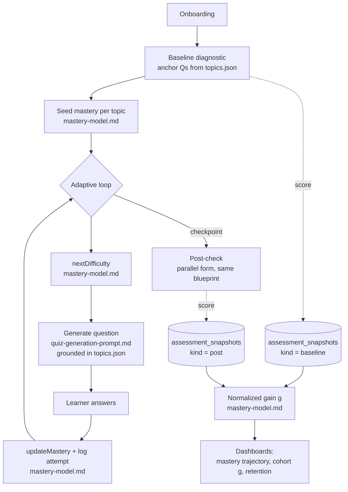

# Generative-Learning AI Tutor — BUSI1620

An adaptive AI tutor for the University of Greenwich module **BUSI1620 "Business Creation
Project"** (Level 6, entrepreneurship / new-venture feasibility). It places each learner per
topic, generates difficulty-scaled questions, tracks mastery, and measures learning gain.

**Success criteria (project brief):** 30+ active learners · measurable improvement in outcomes ·
personalised AI that drives retention.

**Pedagogy:** grounded in generative learning (Fiorella & Mayer) — the tutor makes learners
*generate* (self-test, self-explain, apply a framework to their own venture) rather than
passively read.

---

## The spec bundle

Three files define the learning core. Together they form one loop; each is documented in its own
file.

| File | Role |
|---|---|
| [`topics.json`](./topics.json) | **Content anchors.** 7 topics mapped to the module's 5 learning outcomes, each with key concepts, difficulty-tagged diagnostic questions, and a generative "apply to your own venture" task. |
| [`quiz-generation-prompt.md`](./quiz-generation-prompt.md) | **Generation engine.** System prompt that produces new difficulty-scaled questions grounded in the anchors, using a *derive-answer-first* protocol so answer keys aren't hallucinated. |
| [`mastery-model.md`](./mastery-model.md) | **Estimation + measurement.** Elo-style difficulty-weighted mastery (drives adaptivity) and Hake normalized gain from matched pre/post assessments (the measurable-improvement evidence). |

---

## How the pieces talk

In one sentence: **anchors** seed the baseline, the **mastery model** decides the next
difficulty, the **generator** produces a grounded question at that difficulty, the answer updates
mastery, and two fixed checkpoints yield the learning-gain metric.

---

## Stack

Next.js (App Router) · Supabase (auth + Postgres + RLS) · Anthropic API (`claude-sonnet` for
tutoring, quiz generation, and open-task grading) · deploy to Vercel. Data model additions are
specified in `mastery-model.md` §6.

---

## Building it with Claude Code

Attach all three spec files as context to the planning prompt. They give Claude Code the content,
the generation contract, and the adaptivity/measurement logic up front, so it implements the
defined design instead of inventing its own. Recommended build order is in `mastery-model.md` §7:
mastery update + next-difficulty first, then generation wiring, then the pre/post gain reporting.
